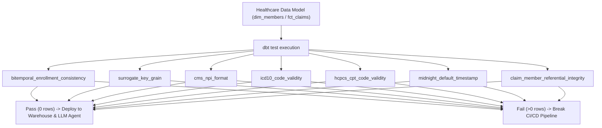

# ARCHITECTURE — refhealth-dbt-healthcare-checks

## Architecture Overview

`refhealth_dbt_healthcare_checks` defines SQL macros adhering to dbt Core generic test conventions. Each test accepts a `model` and target column arguments, returning rows that fail the validation criteria.

